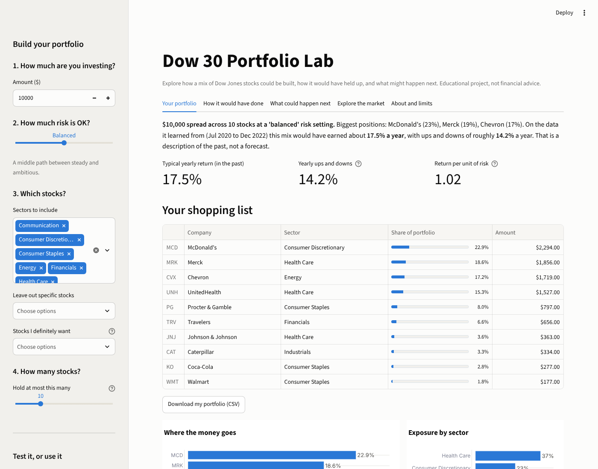
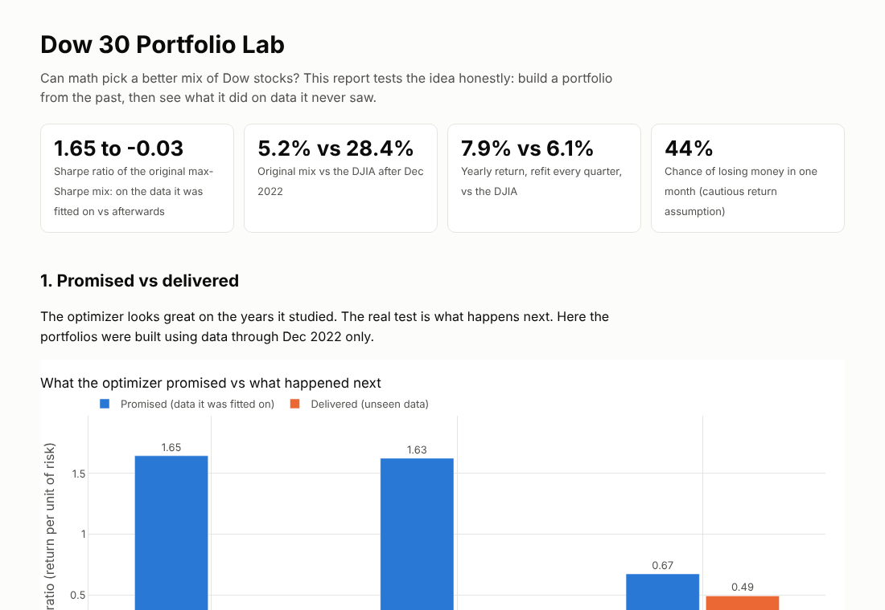
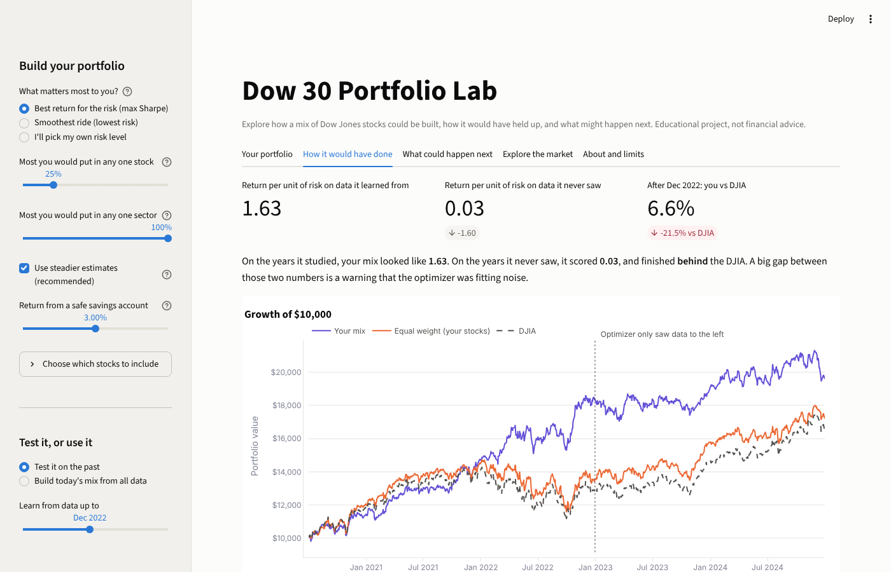

# Dow 30 Portfolio Lab

Can math pick a better mix of Dow Jones stocks? This project builds portfolios with mean-variance optimization, then tests them honestly: fit on the past, judge on data the optimizer never saw. It includes an interactive app for people who do not code.



## The headline finding

The optimizer looked great on the years it studied and fell flat on the years it did not.

| | Sharpe ratio on data it learned from | Sharpe ratio on data it never saw |
|---|---|---|
| Max Sharpe (original method) | 1.65 | -0.03 |
| Max Sharpe (stabilized) | 1.63 | 0.03 |
| Min volatility | 0.67 | 0.49 |

Trained on Jul 2020 to Dec 2022, then held through Dec 2024, the original max-Sharpe mix (25% cap) returned 5.2% while the DJIA returned 28.4%. When the strategy re-learns every quarter instead, results are close to the benchmark and the gaps are small enough to be luck. The honest takeaway: no reliable edge from optimizing on 4 years of history.



## Try it

- **Interactive app:** `streamlit run streamlit_app.py`
  Set how much you are investing, how much risk feels OK (five steps from Very cautious to Aggressive), which sectors and stocks to include or leave out, which stocks you definitely want, and how many stocks to hold. You get a dollar-by-dollar shopping list, then see how the mix would have done on unseen data and what the next week, month, quarter or year could look like.
- **Static report (no install):** open `docs/index.html`. All charts are interactive, so hover over anything.
- **Live links:** _add your Streamlit and GitHub Pages URLs here after deploying._



## What is inside

| Piece | What it does |
|---|---|
| `streamlit_app.py` | The interactive app, written in plain English for non-technical users |
| `portfolio_lab/optimize.py` | Max Sharpe, min volatility, target risk, stock and sector caps, steadier estimates |
| `portfolio_lab/backtest.py` | Train/test split and quarterly walk-forward with trading costs, no look-ahead |
| `portfolio_lab/simulate.py` | Monte Carlo from real-day bootstrap or fitted distributions, with a return-assumption dial |
| `portfolio_lab/plots.py` | The interactive charts |
| `scripts/run_analysis.py` | Rebuilds every table in `results/` and the report in `docs/` |
| `tests/` | 27 tests, including checks that the optimizer cannot peek at the future |
| `notebooks/` | The original course notebook (outputs cleared) |

## Quick start

```bash
pip install -r requirements.txt
streamlit run streamlit_app.py          # the app
python scripts/run_analysis.py          # rebuild results/ and docs/index.html
python scripts/run_analysis.py --refresh  # re-download prices from Yahoo Finance
pytest                                  # run the tests
```

## How it works

1. **Estimate** each stock's expected return and how the stocks move together from a window of prices. The "steadier" option shrinks the risk estimates (Ledoit-Wolf) and pulls expected returns halfway to the average, so the optimizer stops chasing last period's winners.
2. **Optimize** for the best return per unit of risk (Sharpe ratio), the lowest risk, or a chosen point in between, under limits on single stocks and sectors.
3. **Test** by hiding later data from the optimizer, then reporting what happened. A quarterly walk-forward adds realistic refits and trading costs.
4. **Simulate** thousands of possible futures to show a range of outcomes and the chance of losing money.

## Deploy your own

- **App:** push the repo to GitHub, then on [share.streamlit.io](https://share.streamlit.io) choose "Create app", pick the repo, and set the main file to `streamlit_app.py`.
- **Report:** in the repo settings, turn on GitHub Pages from the `main` branch and `/docs` folder.

## Data

`data/dow30_prices_snapshot.csv` holds daily closes for the 30 stocks and the DJIA from 2020-07-01 to 2024-12-30, rebased to 100 on the first day (returns-based analysis does not need the original price scale). It comes from the original project run via Yahoo Finance. Use `--refresh` to pull fresh data.

## Limits

- About 4.5 years of data is a short sample, and past returns do not predict future returns.
- The stock list is the Dow lineup for most of 2020 to 2024. Amazon, Nvidia and Sherwin-Williams later replaced Walgreens, Intel and Dow Inc.
- The DJIA is a price index without dividends, so the equal-weight line is the fairer yardstick.
- Simulations assume future days resemble past days. Taxes are ignored.

**Educational project, not financial advice.**

## Background

Built for DATA 612 (Decision Analytics) at the University of Calgary, then extended. See [docs/CHANGELOG.md](docs/CHANGELOG.md) for what was improved and why.

MIT License.
